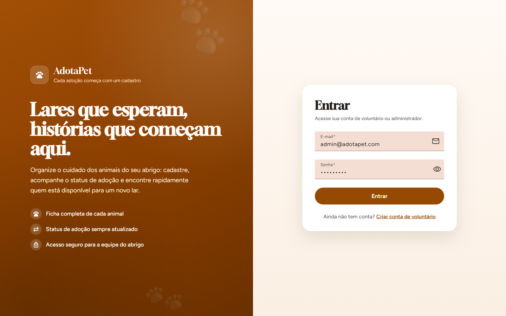
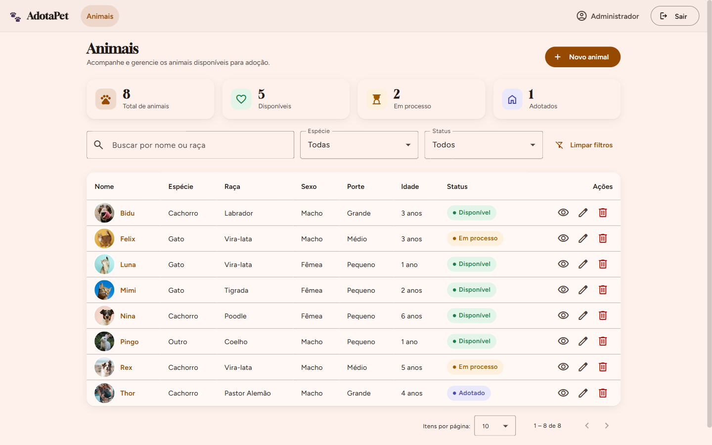
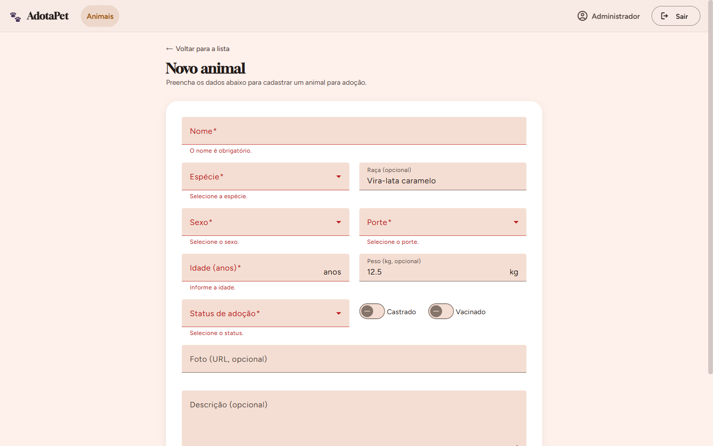
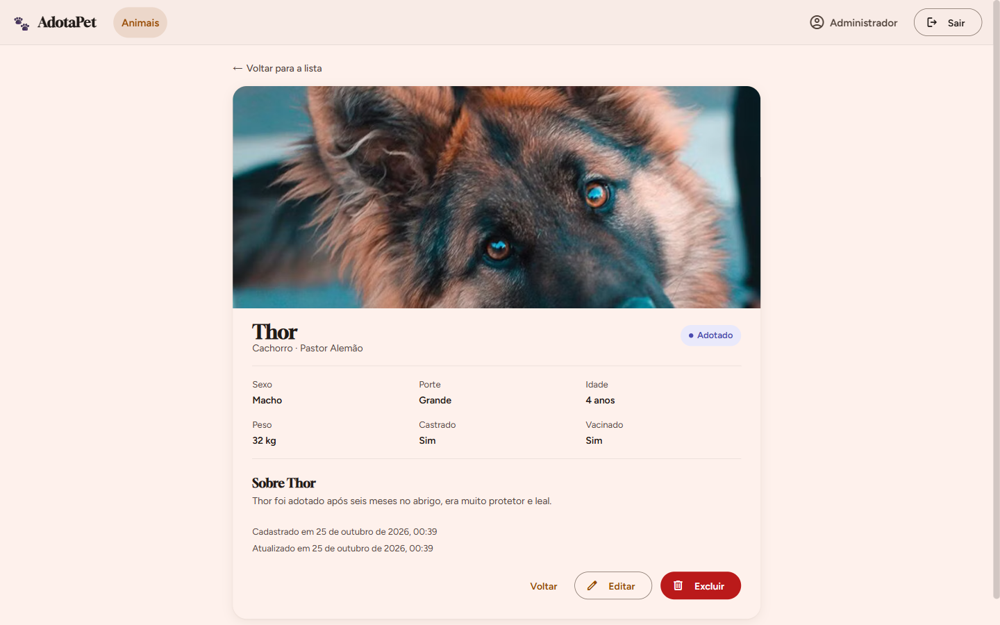
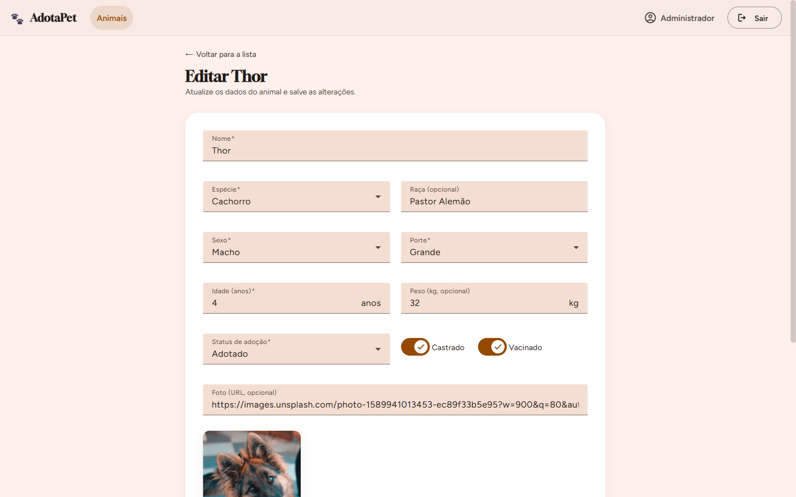
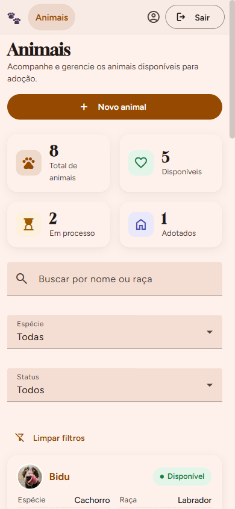

# 🐾 AdotaPet

**Sistema web de gestão de animais para adoção**: MVP full stack com **Angular 22** e **Spring Boot 4**, autenticação **JWT** e persistência em **PostgreSQL**.

Trabalho da disciplina de Desenvolvimento Web: *Desenvolvimento de um MVP web full stack (parte 1)*.

---

## 👥 Integrantes

| Nome | Matrícula | GitHub |
|---|---|---|
| Társis Carvalho Barreto | 202220038 | [@Tarsis59](https://github.com/Tarsis59) |
| Ylo Silva de Sá Bittencourt | 202220039 | [@YloBittencourt](https://github.com/YloBittencourt) |
| Guilherme Crocamo Freire | 202220448 | [@gcrocamo](https://github.com/gcrocamo) |
| Samuel Ferreira Santos | 202410518 | [@SamuelFerrc](https://github.com/SamuelFerrc) |
| João Pedro França Chaves Oliveira | 202320100 | [@joao-pedro-franca](https://github.com/joao-pedro-franca) |

---

## 📌 O problema

ONGs e protetores independentes costumam controlar os animais disponíveis para adoção em planilhas, cadernos e grupos de mensagens. A informação fica espalhada, se perde com facilidade, animais já adotados continuam sendo divulgados e não existe um histórico confiável de cada animal.

## 🎯 Público-alvo

Voluntários e administradores de **ONGs, abrigos e lares temporários** de proteção animal, que precisam de uma ferramenta simples para registrar e acompanhar cada animal até a adoção.

## ✨ Funcionalidades

- **Login** com e-mail e senha validados no backend (JWT com prazo de expiração).
- **Cadastro de conta** de voluntário.
- **Listagem** de animais com indicadores (total, disponíveis, em processo, adotados), busca por nome ou raça, filtros por espécie e status e paginação.
- **Cadastro** de animal com validação completa dos campos.
- **Detalhes** do animal, com todas as informações e o histórico de criação e atualização.
- **Edição** de animal.
- **Exclusão** com diálogo de confirmação.
- Mensagens de **sucesso e falha** em todas as operações.
- **Rotas protegidas**: sem login, o usuário é levado para a tela de login e volta para a página pretendida depois de entrar.
- **Sair do sistema** e encerramento automático da sessão quando o token expira ou é inválido.
- Interface **responsiva** (celular, tablet e desktop) e acessível.

---

## 🏗️ Arquitetura

```
┌──────────────────────┐   HTTP + JSON    ┌───────────────────────────────────────┐   JPA    ┌──────────────┐
│  Angular 22 (SPA)    │  Authorization:  │  Spring Boot 4 (API REST)             │ ───────▶ │  PostgreSQL  │
│  Router · Guards     │  Bearer <JWT>    │  Controller → Service → Repository    │          │  (ou H2)     │
│  Services · Interc.  │ ───────────────▶ │  DTOs · Bean Validation · Security    │          └──────────────┘
└──────────────────────┘                  └───────────────────────────────────────┘
```

| Camada | Tecnologias |
|---|---|
| Frontend | Angular 22 (standalone, signals, zoneless), Angular Material 22, RxJS, Vitest |
| Backend | Java 21, Spring Boot 4.1, Spring Web MVC, Spring Security, Spring Data JPA, Bean Validation, jjwt 0.12, springdoc-openapi (Swagger) |
| Banco | PostgreSQL 17 (Docker) ou H2 em arquivo (alternativa sem Docker) |
| Testes | JUnit 5, Mockito, MockMvc (backend) · Vitest (frontend) |

### Estrutura de pastas

```
backend/src/main/java/br/com/adotapet/
├── config/       Segurança, CORS, OpenAPI e carga inicial de dados
├── controller/   AuthController, AnimalController (endpoints REST)
├── service/      Regras de negócio (AuthService, AnimalService)
├── repository/   Spring Data JPA + Specifications para busca e filtros
├── domain/       Entidades JPA (Usuario, Animal) e enums
├── dto/          Records de entrada/saída e mappers
├── exception/    Exceções de negócio e tratamento global de erros
└── security/     JwtService, filtro JWT, respostas 401/403 em JSON

frontend/src/app/
├── core/         models, services (auth, animal, notificação), interceptor e guards
├── shared/       layout (shell com barra superior e "Sair") e diálogo de confirmação
├── features/
│   ├── auth/     login, registrar
│   └── animais/  listagem, cadastro, detalhes, edição e formulário compartilhado
└── not-found/    página 404
```

---

## 🚀 Como executar

### Pré-requisitos
- **Java 21** (o Maven não precisa estar instalado: o projeto usa o Maven Wrapper)
- **Node.js 22.22+** (ou 24.15+) com npm
- **Docker** (opcional, para o PostgreSQL)

### 1. Banco de dados (PostgreSQL via Docker)
```bash
docker compose up -d
```
Sobe o PostgreSQL 17 na porta **5434** (banco, usuário e senha: `adotapet`). Os dados ficam em um volume Docker e **continuam salvos após reiniciar**.

### 2. Backend (porta 8080)
```bash
cd backend
./mvnw spring-boot:run          # Windows: mvnw.cmd spring-boot:run
```
Na primeira execução são criados o usuário administrador e 8 animais de exemplo.

> **Sem Docker?** Rode com o perfil H2, que salva os dados em arquivo (`backend/data/`) e também persiste após reiniciar:
> ```bash
> ./mvnw spring-boot:run -Dspring-boot.run.profiles=h2
> ```
> Console do H2: http://localhost:8080/h2-console (JDBC URL `jdbc:h2:file:./data/adotapet`, usuário `sa`, sem senha).

### 3. Frontend (porta 4200)
```bash
cd frontend
npm install
npm start
```
Acesse **http://localhost:4200**.

### 🔑 Credenciais de demonstração
| Perfil | E-mail | Senha |
|---|---|---|
| Administrador | `admin@adotapet.com` | `Admin@123` |

Também é possível criar uma conta de voluntário pela tela **Criar conta**.

### 📖 Documentação da API (Swagger)
http://localhost:8080/swagger-ui.html. Para testar as rotas protegidas, faça login em `POST /api/auth/login`, copie o `token` e clique em **Authorize**.

### 🧪 Testes automatizados
```bash
cd backend && ./mvnw verify                # 28 testes: unitários + integração (MockMvc, H2 em memória)
cd frontend && npm test -- --watch=false   # testes de AuthService, guard, interceptor e app
```

### ⚙️ Variáveis de ambiente (opcionais)
| Variável | Padrão | Descrição |
|---|---|---|
| `DB_URL` | `jdbc:postgresql://localhost:5434/adotapet` | URL JDBC do banco |
| `DB_USERNAME` / `DB_PASSWORD` | `adotapet` / `adotapet` | Credenciais do banco |
| `JWT_SECRET` | chave de desenvolvimento | Segredo de assinatura do JWT (**defina em produção**, mínimo de 64 caracteres) |
| `CORS_ORIGEM` | `http://localhost:4200` | Origem permitida para o frontend |
| `DB_PORT` (docker compose) | `5434` | Porta do PostgreSQL no host |

---

## 🔌 Endpoints da API

Base: `http://localhost:8080/api`. Todos os erros seguem o formato `ErroResponse` (`timestamp`, `status`, `erro`, `mensagem`, `caminho`, `campos`).

| Método | Rota | Autenticação | Sucesso | Erros tratados |
|---|---|---|---|---|
| `POST` | `/auth/login` | pública | `200` token JWT + usuário | `400` dados inválidos · `401` credenciais incorretas |
| `POST` | `/auth/registrar` | pública | `201` usuário criado | `400` · `409` e-mail já cadastrado |
| `GET` | `/auth/me` | Bearer | `200` usuário logado | `401` |
| `GET` | `/animais?busca=&especie=&status=&page=&size=&sort=` | Bearer | `200` página de animais | `400` · `401` |
| `GET` | `/animais/estatisticas` | Bearer | `200` totais por status | `401` |
| `GET` | `/animais/{id}` | Bearer | `200` animal | `401` · `404` |
| `POST` | `/animais` | Bearer | `201` + cabeçalho `Location` | `400` · `401` |
| `PUT` | `/animais/{id}` | Bearer | `200` animal atualizado | `400` · `401` · `404` |
| `DELETE` | `/animais/{id}` | Bearer | `204` | `401` · `404` |

Respostas `401` diferenciam os casos: *"E-mail ou senha inválidos."*, *"Autenticação necessária."*, *"Token inválido."* e *"Token expirado. Faça login novamente."*.

### Fluxo de autenticação
1. O usuário informa e-mail e senha na página de login.
2. O backend valida as credenciais (senha comparada com o **hash BCrypt** salvo no banco) e devolve um **JWT assinado (HMAC-SHA)** com expiração de **2 horas**.
3. O Angular guarda o token e o `authInterceptor` envia `Authorization: Bearer <token>` em todas as requisições protegidas.
4. O `JwtAuthenticationFilter` valida assinatura e expiração antes de liberar o acesso. Se o token for inválido ou estiver expirado, a API responde `401` e o frontend encerra a sessão e volta para o login.
5. A senha **nunca** é devolvida pela API: os DTOs de resposta não têm esse campo.

---

## ✅ Requisitos atendidos

| Requisito do enunciado | Onde está |
|---|---|
| 4 páginas funcionais além do login, com navegação | Listagem, Cadastro, Detalhes e Edição (+ Criar conta e 404): `frontend/src/app/app.routes.ts` |
| Login autenticado no backend (sem simulação) | `LoginComponent` → `AuthService.login()` → `POST /api/auth/login` |
| Angular Router | `app.routes.ts`, rotas com lazy loading |
| Consumo da API por serviços Angular | `core/services/auth.service.ts`, `core/services/animal.service.ts` |
| Validação de formulários com mensagens compreensíveis | Reactive Forms em login, registrar e no formulário de animal; erros `400` do backend exibidos no campo correspondente |
| Mensagens de sucesso ou falha | `NotificacaoService` (snackbars) |
| Confirmação antes de excluir | `ConfirmDialogComponent` na listagem e nos detalhes |
| Rotas protegidas | `authGuard` / `guestGuard` |
| Opção de sair | Botão **Sair** na barra superior (`ShellComponent`) |
| CRUD completo de uma entidade principal (não usuário) | `Animal`: `AnimalController` (POST, GET lista, GET por id, PUT, DELETE) |
| Controllers, services e repositories separados | pacotes `controller`, `service`, `repository` |
| DTOs nas entradas e saídas | pacote `dto` (records), as entidades nunca são expostas |
| Validação dos dados recebidos | Bean Validation nos DTOs + `GlobalExceptionHandler` |
| Códigos HTTP adequados e erros tratados | `200/201/204/400/401/403/404/409/500` em JSON |
| Banco relacional com Spring Data JPA | PostgreSQL 17 (ou H2), entidades com anotações JPA |
| Persistência de usuários e registros após reiniciar | tabelas `usuarios` e `animais`, `ddl-auto: update`, volume Docker / arquivo H2 |
| Spring Security + JWT com expiração | `SecurityConfig`, `JwtService`, `JwtAuthenticationFilter` |
| Token no cabeçalho `Authorization: Bearer` | `core/interceptors/auth.interceptor.ts` |
| Senhas com BCrypt e nunca devolvidas | `PasswordEncoder` BCrypt; `UsuarioResponse` sem senha |
| Credenciais incorretas e token inválido/expirado tratados | `JsonAuthenticationEntryPoint` + testes `AuthControllerIT` / `AnimalControllerIT` |

---

## 🖼️ Telas

| Login | Listagem |
|---|---|
|  |  |
| **Cadastro (validação)** | **Detalhes** |
|  |  |
| **Edição** | **Celular** |
|  |  |

> As fotos dos animais de exemplo vêm do [Unsplash](https://unsplash.com) (licença livre). Sem internet, o sistema mostra um ícone da espécie no lugar da foto.

---

## 🎤 Apresentação

- Slides em PowerPoint, com as falas nas anotações do apresentador: [`docs/apresentacao/AdotaPet-Apresentacao.pptx`](docs/apresentacao/AdotaPet-Apresentacao.pptx)
- Slides em PDF: [`docs/apresentacao/AdotaPet-Apresentacao.pdf`](docs/apresentacao/AdotaPet-Apresentacao.pdf)
- Roteiro completo, com a fala de cada integrante: [`docs/ROTEIRO-APRESENTACAO.md`](docs/ROTEIRO-APRESENTACAO.md)
